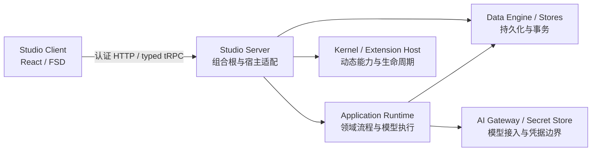

# 系统组成与源码探索路线

本页说明当前 Studio 的模块关系与阅读入口。局部实现、依赖用法和文件地图由对应 Workspace README 维护；跨模块行为合同仍由各领域 Architecture 维护。

## 系统由谁组成



Server 分别组装 Runtime、Kernel 和 Store；Application Runtime 不通过 Kernel 编排业务。Client 通过 API 消费服务，不直接加载 Server、数据库或 Runtime 的运行时代码。

| 要理解的部分 | 所有者与下一阅读入口 |
| --- | --- |
| 前端层次、状态、界面组装与依赖复用 | [Client README](../../apps/studio-client/README.md#源码导航与-fsd-架构规范)；FSD 是本项目的实际分工，Entities 当前以 DTO / 类型为主 |
| 进程启动、HTTP、认证、RPC、服务注入与关闭 | [Server README](../../apps/studio-server/README.md#组合根与启动前提) |
| Card、Timeline、Session、Prompt、工具与导入导出流程 | [Application Runtime README](../../packages/application-runtime/README.md#源码导航) |
| Transcript、正文索引、State、Workspace、资源树与统计 | [Application Data README](../../packages/application-data/README.md)；共享事务基座见 [Data Engine](../../packages/data-engine/README.md) |
| 版本化 Document 与 Blob / 媒体资产 | [Document Store](../../packages/document-store/README.md)、[Asset Store](../../packages/asset-store/README.md)；它们不替代上述领域 Store |
| 动态扩展方法、事件和 Server Module 生命周期 | [Kernel](../../packages/kernel/README.md)、[Extension Host](../../packages/extension-sdk/extension-host/README.md)、[SDK 作者合同](../../packages/extension-sdk/README.md) |
| 模型调用、凭据、文本计数、日志与诊断 | [共享平台能力入口](platform/README.md) |
| UI 原语、主题与宿主容器 | [UI Architecture](ui/README.md)、[UI 包](../../packages/loom-ui/README.md) |

## 一次请求经过谁

```text
界面事件 → Feature / App 组装 → Client StudioApi → typed tRPC client
  → Server HTTP 认证与请求预算 → procedure 输入校验与可信 Context
  → Application Runtime / 宿主服务 / Kernel 动态网关
  → 领域 Store 或 Gateway → 响应与领域运行进度 → Feature → 界面
```

这条路线表示职责交接，不要求每次操作经过所有模块。HTTP 文件入口、Extension Catalog SSE 和 Agent Run 的流式观察有各自通道，入口见 [Server HTTP 面](../../apps/studio-server/README.md#当前-http-面)。主应用 `AppRouter` 是跨端类型来源；动态扩展网关仍需运行时权限和输入合同，不因为有 typed client 就获得静态业务保证。

跨领域阅读时保留以下边界，细节继续进入对应合同：

- **权威数据与投影**：Timeline 根 Session 保存 canonical 内容历史，Narrative Branch / Node 关联采用路径与正文索引；Provider messages 是执行投影。见 [Runtime 与 Session](application/agent/runtime-and-session.md)。
- **提交边界**：用户正文提交、Run 启动、Transcript 和工具副作用不能笼统视为一次原子事务。见 [数据能力与生命周期](application/data-capabilities-and-lifecycle.md)。
- **界面状态**：History 导航、Query 远端缓存、Zustand 偏好、编辑草稿及流式执行分别有所有者。见 [Client 状态入口](../../apps/studio-client/README.md#状态与外部依赖所有权-external-dependency-ownership)。
- **安装与消费**：资源安装、授权、启用、采用及本轮消费是不同事实；Server 扩展是可信同进程代码。见 [扩展架构](extensions/README.md)。

## 如何沿文档进入代码

```text
已知领域：Architecture 分类 → Workspace README → 必要的局部 README → 源码与相关验证
已知任务：Workspace 开发路由 → 目标 Workspace README → 同一路线
已知方法：RPC / 类型速查 → owning source → 所属模块说明
```

[任务路由](../guide/workspace-development.md)、[RPC 导航](../workbench/reference/rpc-methods.md)与[类型速查](../workbench/reference/core-types.md)各有用途；不要求接手任务时逐页通读。

Workspace README 维护包的入口、依赖边界和模块导航。只有内部协作复杂、容易误入其他所有者的模块才增加局部 README，说明：从哪里读起、谁负责哪一步、影响运行的注入/环境/权限前提，以及已有的相关验证。简单模块继续链接源码，不为每个目录生成文档。

Architecture 保留跨模块约束；包与局部 README 链接这些约束，并维护靠近实现的事实。不要在三层复制 API、Schema、完整文件清单或同一份依赖说明。普通内部源码路径用于阅读定位，跨包调用仍须遵循目标包的 public exports。
