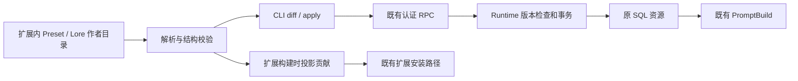

# 资源作者工作流与 DX

状态：W0—W3 首版已实现；W4 Preset XML 编排改造已实现，正则改造仍独立推进。
更新：2026-11-02。已实现作者合同、目录编解码、Runtime/RPC/CLI 同步与扩展 staging 构建；未安装到用户实例或发布。

## 目标与归属

让作者和 AI 直接编辑 Preset／Lore 目录，经解析、校验和显式 Apply 进入现有 Runtime；不要求每次编辑先生成 JSON 或资源包。

- 日常创作：编辑 MD／YAML → CLI 触发解析与校验 → 同步原数据库资源 → 通过现有运行时预览／使用；用户可显式开启 Watch 自动触发同一同步路径。
- 对外分发：同一作者目录 → 同一解析与校验 → 生成现有可安装扩展包 → 安装验收。

包是发行产物，不是预览前置。本文的 Apply 指 CLI 将文件修改提交到原数据库资源的动作，不要求额外在应用内点击一次。文件格式转换不代替运行时 PromptBuild；变量展开、条件激活、锚点填充和消息组织继续由现有运行链路负责。

本页是资源作者工作流的唯一活动主计划，合并以下三处的相关范围；原页不再维护平行的资源创作实施路线：

| 原入口 | 合并到本页 | 原入口保留 |
| --- | --- | --- |
| [扩展开发体验](./extension-developer-experience.md) | 资源作者格式、校验与构建工具、官方资源样例 | 公开 SDK/UI、自省、扩展代码脚手架、设置演进 |
| [CLI/MCP 适配](./application-capability-cli-mcp-adapters-plan.md) | 资源创作所需的在线 CLI、导出／差异／Apply、连接认证 | 通用应用控制、Capability 候选、MCP；不作为本页的默认前置 |
| [Card 来源与开发工作区](./workspace-resource-and-distribution-plan.md) | 作者编辑源、草稿、与数据库的冲突、显式 Apply | Card 外部来源、下载与更新语义 |

[旧 Workspace 开发模式计划](../../archive/plans/workspace-dev-sync-plan.md)仅为历史参考，不恢复其完整同步路线。本页对作者格式的新讨论不自动取代现有交换格式。

## 已核对事实

- [Prompt Resource 文件编解码](../../../apps/studio-server/src/codecs/prompt-resource-files.ts)将正文写入 MD，递归节点元数据与正文路径写入 `loom.promptResource.files.v1` 索引；路径按数组位置生成。它已有恢复与缺失正文检查，不是待从零建设的能力。
- [树存储](../../../packages/application-data/src/prompt-resource/tree.ts)允许非负整数 `orderIndex`，但 `flattenTree` 仍按连续下标赋值；读取时按排序值及 ID 排序。当前树表示主要保留相对次序，不保留原始稀疏数值。
- [创建和移动入口](../../../packages/application-runtime/src/runtime/prompt-runtime.ts)按数组下标计算插入位置，并为受影响的兄弟节点生成重排操作。仅把默认步长改为 10，不能形成完整的稀疏排序实现。
- [资源读取](../../../packages/application-runtime/src/cards/workspace.ts)按输入资源列表收集；[条目收集](../../../packages/application-runtime/src/cards/workspace-codec.ts)按树的深度优先顺序生成贡献。树顺序已经参与构建，不只是 UI 展示信息。
- [PromptBuild](../../../packages/application-runtime/src/prompt/prompt-build-pipeline.ts)沿预设骨架放置锚点，在同一锚点内优先按 `localDepth` 排序；相同或均未设置时保留贡献收集顺序。不能直接宣称文件树顺序无条件等于最终注入顺序。
- 现有 Card 目录、保存与 Apply 边界见 [Card Bundle 文件合同](../../architecture/application/card-bundle-files.md)、[目录服务](../../../apps/studio-server/src/resource-directories/)与[目录同步 Runtime](../../../packages/application-runtime/src/runtime/card-directory-sync.ts)。本页复用这些能力，不复制另一套打包或持久化逻辑。
- [节点 SQL Schema](../../../packages/application-data/src/prompt-resource/schema.ts)已有独立字段、`capabilities_json`、`extra_json` 和资源级 `metadata_json`；[Runtime 与 Artifact 类型](../../../packages/application-runtime/src/cards/workspace-types.ts)并不完全相同。必须按下方作者配置／用户配置边界核对往返；模型和审批不进入发行物是已确认的产品边界，不能将其视为需要补齐的 Artifact 缺陷。

## 已确认方向与首版边界

- 用一份主计划协调作者格式、工具和 Studio 接入；先完成基础闭环，再以诺姆助手深化内容与能力验证。
- 首版先做 Preset 与 Lore 的目录表达、读取校验和 CLI 同步原资源；发行打包是独立出口。脚本自身的目录映射、构建与执行后续再做，已有脚本及其他资源引用仍须保留。允许用户显式开启可选 Watch，复用 CLI 同步的校验、身份和冲突规则；不因此引入连续双向同步、完整开发模式、通用 Shell、自动 Git 或远程发布。
- 文件编号采用 `010、020` 留间隔的方向继续设计；它表达同级相对顺序，不是所有 Lore 共用的全局权重。数据库稀疏排序与文件表示一并核对，不能只做文件外观。
- 保留稳定资源／节点身份；重命名、移动和重新编号不能隐式创建新身份。文件与数据库往返至少保留相对次序，不要求两侧排序数字逐字相同。
- 同一排序事实只有一个作者侧权威，避免文件名前缀、index 和正文 metadata 三处独立维护。
- 复用现有资源 Schema、编解码、安装和 Apply；访问 Studio 状态的命令连接运行中的服务，不直接打开 SQLite 或另嵌 Runtime。
- 真实文件目录是原资源的编辑入口，不是副本。默认由 CLI 指令同步回原 DB 资源，只有用户开启 Watch 后才自动触发；保留资源及节点身份，不重新导入为副本。导出文件不转移运行时权威，不改变 Timeline 的不可变材料或恢复点；无效草稿与冲突必须可见，失败不能静默丢失编辑。
- 模型绑定、流式输出配置和审批策略由使用者自己选择，不由作者分发。作者文件同步及发行安装不能通过省略字段清空已有用户选择，也不能带入作者的模型绑定或审批授权。
- [诺姆助手](../../../official/extensions/loom-assistant/NOM-ASSISTANT.md)作为首个真实样例，覆盖知识 Lore、预设和随扩展携带的媒体；知识资源应可被其他助手引用，不能因样例而绑定专用运行逻辑。

## W4：Preset 显式编排（2026-11-02，已确认）

本节取代下方 W0 中 **Preset** 的目录编排规则；Lore 与旧目录读取仍沿用 W0。正文只存在于 MD，XML 不接受正文，不执行 TSX／Vue 或表达式。

- `composition.xml` 是 Preset 消息边界、逻辑分组与引用顺序的唯一权威。`Message id/name/role` 表达一条消息；`Group id/name` 表达有运行语义的逻辑 Folder；`Entry src="./010-正文.md"` 按路径引用正文；`Slot id/name/anchor` 表达既有虚拟锚点。
- 引用按路径定位，稳定节点 ID 继续保存在 MD frontmatter。XML 不重复 Entry ID；文件重命名／移动必须同步引用，缺失时报错，不扫描猜测替代项。Message／Group／Slot 自身 ID 和名称在 XML。
- 保留 MD 数字前缀，便于作者和 Agent 浏览；它不覆盖 XML 顺序。物理分类目录不自动变成 Folder、不决定启用状态。相同编号不再决定 Preset 的逻辑冲突；Lore 编号规则不变。
- `resource.yaml` 保留资源配置；新增文件层 `compositionMetadata`，按 Message／Group／Slot ID 保存复杂既有节点属性（capabilities、extra、已有容器 body）；enabled、category、meta 直接作为 XML 属性。roleHint／targetAnchorId 由 XML 对应属性负责，不允许双重声明。该辅助字段不进入 Runtime 合同；Entry 属性仍在 MD。
- 同一 Entry 文件首版只能引用一次，所有逻辑节点 ID 仍唯一；不引入正文共享实例模型。未被引用的作者文件报错，避免遗漏正文后静默应用删除。
- 新导出使用 XML；无 XML 的旧 Preset 目录仍可读取。旧格式转换采用读取旧树再导出到新目录，保留 ID、正文、启用状态和节点顺序，不原地自动覆盖用户目录。
- 导出按编排遍历生成 `010-名称.md` 等规范化路径；不保存作者原物理目录和文件名映射。保证领域资源等价往返，不承诺原始路径、注释或排版无损往返。保留自定义目录的原作者源仍是日常编辑入口。
- 不改变 `AuthoringResource`、SQL、版本冲突、原子 Apply、PromptBuild 与 `loom.promptResource.files.v1` 包内格式。XML 解析禁用 DTD／外部实体，不允许路径越界或符号链接。

施工位置：`apps/studio-server/src/codecs/resource-authoring.ts` 负责格式选择及文件读写；`preset-composition.ts` 负责 XML 编排；CLI 和 `scripts/pack/extension-authoring.ts` 复用原入口。迁移 `official/extensions/loom-assistant/authoring/assistant`，重建助手资源产物。Lore、角色正文和正则不在改造范围。

验收：新旧格式读取、XML/MD 往返、改名保持 ID、XML 顺序优先、缺失／重复／越界引用和非法消息嵌套；CLI 离线 check、扩展 staging 构建及诺姆迁移前后领域树等价。不安装、不 Apply 到用户实例、不发布。

实施结果：新增严格 XML 编排 codec，使用 saxes 6.0.0；CLI XML 错误返回校验退出码 2。新 Preset 导出 XML，旧目录与 Lore 保持可读。诺姆作者目录已迁移，原目录备份在 `/tmp/loom-nom-authoring-before-wljcy1`；迁移前后领域树深比较一致，重新构建的 assistant-preset.json 与原安装产物完全等价。

验证：文件 codec 6 项、扩展构建 7 项、CLI Lore 1 项通过；新增 XML Preset 在线导出／check／diff／apply／watch／冲突案例单独通过。服务端 TypeScript 检查通过，诺姆 Preset 与 Lore 离线 check、完整扩展 staging 构建通过。没有操作用户运行实例。

发现但未扩展修复的既有问题：普通 createPromptResource 默认 Preset 的 `official/codeact_json` 挂载含 Content 配置，authoring Apply 拒绝 Structured Tool 的 Content placement。XML CLI 测试改用显式作者创建的合法 Preset；该默认工具挂载问题仍待独立处理，不能将 XML 迁移通过视为它已修复。


## 已确认的作者表示

以下记录 W0 已实现的目录格式；Preset 新导出以 W4 为准，旧格式仍可读取，Lore 继续使用本节格式。

```text
诺姆助手/
├── resource.yaml
├── 010-身份设定.system.message/
│   ├── message.yaml
│   ├── 000-README.md                 # 可选的普通条目
│   ├── 010-助手身份.md
│   └── 020-常驻知识.anchor.yaml
├── 020-会话历史.anchor.yaml
└── 030-用户输入.user.message/
    ├── message.yaml
    └── 010-用户输入.anchor.yaml

角色知识/
├── resource.yaml
├── 010-爱丽丝/
│   ├── 010-简要摘要.md
│   └── 020-战斗习惯.md
└── 020-伊蕾娜/
    ├── 010-简要摘要.md
    └── 020-旅行习惯.md
```

### 节点、名称与正文

- 普通 `.md` 表达 Entry，YAML Frontmatter 保存节点属性，Markdown 保存正文；Lore 不添加 `.entry.md`，Preset 中的正文也沿用普通 `.md`。
- `.anchor.yaml` 表达锚点声明，映射现有 `kind: virtual`。其稳定节点 ID 与 `capabilities.targetAnchorId` 分开；可有作者描述，但描述不成为提示词贡献。锚点自身接收贡献，不能把说明误当作注入正文。
- `010-身份设定.system.message/` 从左到右表达同级顺序、显示名称、角色、节点类型。读取器从右侧识别固定后缀，生成 `kind: message` 与 `capabilities.roleHint`；改角色后缀就是业务修改，不是纯装饰。
- Message 的名称、角色、类型和顺序以目录路径为作者侧权威，不在 `message.yaml` 重复维护；该 YAML 保留稳定 ID、启用状态、条件等属性。改名不改变身份。普通目录与普通 MD 的 label 规则见下方 W0 细则。
- Message 是消息容器，遵守现有禁止嵌套的约束；`@chat.session` 展开原生消息序列，不作为普通文本入口。支持的角色值及历史 `developer` 归一化必须沿用或显式修订现有合同，不通过文件命名隐式改变。
- 不强制 README，不给它保留名称或独立解析通道。`000-README.md` 若存在，就是应用内、SQL 与文件系统中同一普通 Entry；是否参与 Prompt 按普通条目属性处理，名称和 `000` 不赋予特殊语义。
- 不因目录化删除现有容器 `body`，也不强制将其迁移为 README。YAML 可保存描述／已有正文属性；保存正文与参与 Prompt 是两回事，容器正文消费规则沿用现有实现。首版保留既有 body，不新增 description 字段。
- 带 `.message` 后缀的路径仍是真实目录；读取器先判断文件／目录类型再解析名字，不按字符串后缀假定文件系统类型。

### 资源配置与 KV 映射

`resource.yaml` 承载 Preset／Lore 自身配置；发行单位始终是扩展。开发目录不是独立 Preset ZIP，也不拥有媒体携带能力。扩展 manifest 声明贡献并负责携带文件，预设只保存引用。

| 字段／信息 | 首版归属与行为 |
| --- | --- |
| `macros / macroOptions` | `resource.yaml`；文本变量配置，不建立独立宏资源或宏引用系统 |
| `useCardLore / useGlobalLore` | `resource.yaml`；保留显式 false，沿用既有运行语义 |
| `metadata.icon` | 使用既有 `{kind: package, packageId, path}`；path 相对扩展根目录，不能指向作者本机附件；安装 target 由应用补充 |
| Lore／工具引用 | 作者声明，复用既有贡献引用结构；启用、条件、顺序、内容位置等已存在属性不能丢失 |
| 正则／提取器 | 另一会话正在改造。本阶段不设计新格式、不迁移 `textUses`、不改规则执行；现有 manifest 声明与数据库挂载原样保留 |
| 脚本 | 不做源码文件化；保留已有引用、挂载及本地授权，不顺带修改 |
| `model / approvalPolicy / delivery` | 不导出到作者配置，不接受作者 Apply 覆盖；缺省而非 null。更新保留本地值，新建沿用应用默认。提供商动态选择流式是另一项运行时工作，本计划不声称已有 |
| `historyPolicy` | 首版作者格式不暴露；保留数据库既有值，不删除 Runtime 字段，不迁移为每层总结。后者保留压缩记忆，与忽略会话历史不等价 |
| 节点字段 | Frontmatter／YAML 保留 id、enabled、meta、category、capabilities、extra 和非 Entry 的已有 body；Entry body 在 MD 中 |
| 来源、时间、版本、删除记录 | 宿主管理；禁止借作者 metadata 覆盖。同步版本与资源关联单独保存在本地绑定中 |

作者拥有字段采用完整快照语义：false 为关闭，空数组为清空；缺省按既有领域默认／可选值处理，不能偷偷保留已删除的作者配置。非作者字段按白名单以外保留。未知顶层拼写报错；合法节点 extra 原样往返；数据库未知 metadata 不导出为可写字段，也不得在 Apply 时丢弃。

## 已核对的施工事实

- [文件编解码](../../../apps/studio-server/src/codecs/prompt-resource-files.ts)已有树与 Markdown 分离、路径和大小校验，但使用位置索引；新增作者格式应与旧交换格式并存，不能直接改旧格式语义。
- [存储映射](../../../packages/application-runtime/src/prompt/prompt-resource-mapper.ts)重新组装 metadata。作者 Apply 不能直接调用它覆盖整份 header，必须从当前 SQL metadata 合并作者白名单。
- [树变更合同](../../../packages/application-data/src/prompt-resource/types.ts)已有 `tree.replace`、`resource.update`、`expectedVersion`；[Card 同步](../../../packages/application-runtime/src/runtime/card-directory-sync.ts)展示了 dataEngine 事务与 promptResources.transaction 的使用，但明确拒绝增删资源身份，不能原样当作 Preset／Lore 同步器。
- [现有 CLI](../../../apps/studio-server/src/cli.ts)是启动服务的入口，不是资源命令；资源命令应独立入口，不能导入它启动第二套服务。
- [认证](../../../apps/studio-server/src/http/application-session-auth.ts)是本地 Origin 与 session cookie；[HTTP 入口](../../../apps/studio-server/src/http/http-server.ts)提供 `POST /auth/session`。CLI 可作为本地客户端复用，不新增免认证 RPC 或直接打开 SQLite。
- [RPC 资源入口](../../../apps/studio-server/src/rpc/trpc/application/workspaces.ts)、[Runtime 组装](../../../packages/application-runtime/src/runtime/runtime.ts)已有明确接线位置。
- [诺姆 manifest](../../../official/extensions/loom-assistant/manifest.json)已声明 Preset、Lore、脚本及文本规则；[扩展安装器](../../../apps/studio-server/src/extensions/extension-package-installer.ts)按 manifest 校验安装。`pack-official-content.ts` 使用 catalog.json，是另一套内容目录，不能误当本任务扩展打包入口。

## 最小实施设计



### W0 中直接落实的格式细则

这是本轮主 Agent 给出的首版实现选择，不要求重开产品讨论：

- `resource.yaml` 用 `format: loom.resource.authoring`、`schemaVersion: 1` 标识；仅接受 preset／lore。资源自身 ID 与 rootNode ID 分开，根节点属性用 `rootNode` 保存，根显示名称在这里保存。
- 普通目录用 `folder.yaml` 保存稳定 ID 和其余节点属性；Message 用 `message.yaml`；Entry 用 Frontmatter；锚点用 `.anchor.yaml`。这些元数据文件不作为 Prompt 条目枚举。
- 普通目录／MD 与 Message 一样，从路径去除数字前缀和保留后缀得到 label；YAML 不再重复 label。根目录名称不决定资源身份和名称。保留节点 `body`，不新增会参与 Prompt 的 description 字段。
- 业务节点必须有十进制数字前缀；同级重复编号、缺编号报文件定位错误。数字控制相对顺序，导出默认每隔 10 编号；数据库仍允许连续 orderIndex，不做全仓稀疏排序迁移。PromptBuild 的 localDepth 与现有贡献优先级保持不变。
- 导出保留所有已有 ID；新节点必须有 ID，缺失时校验报错并提示补齐，读取和 Watch 不偷偷生成身份。新资源通过显式 create/bind 流程获得宿主 ID；扩展 contribution ID 不等于安装后资源 ID。
- 本地绑定放 `.loom/authoring-state.json`，记录 endpoint、资源／contribution 映射、上次确认版本与作者投影摘要；不携带 cookie，不进入扩展发行物。导出不覆盖非空目标目录；后续显式导出到新目录用于比较，不自动双向覆盖。

### 同步与命令边界

- 单资源是首个可运行闭环；同一命令的多资源 Apply 在 W2 后段用同一 dataEngine 事务完成。先校验整批、解析引用及检查版本，再写入；不循环调用各自提交的单资源 API 冒充原子批处理。
- Apply 在事务内复核版本，保留非作者字段；已有树节点的删除属于显式 diff。整个资源目录丢失或缺少绑定不能删除数据库资源。跨资源移动节点首版报错，资源内移动保持 ID。
- DB 自绑定后改变即报告冲突，不自动合并、不提供隐式 force。提交成功后才更新绑定；提交成功但本地状态写入失败时明确报出，允许通过服务端当前投影与提交摘要核对后恢复绑定，不能盲目重复创建资源。
- 无差异 Apply 不增加版本。失败不发布半棵树。引用解析依赖贡献 ID 与安装目标，不能猜测全局资源或使用另一个安装的同名资源。
- 开发入口拟定 `scripts/dev/resource-authoring.ts`，命令 `check / export / diff / apply / watch`；创建新目标通过显式 `apply --create`，已绑定目录拒绝 create。参数命名可局部调整，不能改变身份与提交语义。
- check 离线校验目录、节点和包内路径；安装目标、工具可用性等只在线验证。离线通过不能报告运行可用。
- 在线显式 `--endpoint`，绑定后可沿用；限本地 loopback，不自动扫描服务。复用 `/auth/session`，同源 Origin 和 cookie 只留进程内存。认证失败明确退出，不修改服务安全策略。
- CLI 输出支持 JSON 诊断；退出码区分成功 0、校验 2、冲突 3、连接／运行失败 1。日志与结构化输出分流。
- Watch 复用完整 check/diff/apply，合并文件编辑事件，串行提交；中间态不提交，冲突后停止自动提交并报告。关闭 Watch 后不再写 DB。不引入自动 Git、自动发行或模型调用。

## 施工工作包与写入范围

路径标“新增”的文件尚不存在；实施时可以在同职责目录内拆小文件，不能因此扩大领域范围。主 Agent 负责接口与集成判断，不默认要求多代理施工。

| 顺序 | 施工地点 | 交付与停止条件 |
| --- | --- | --- |
| W0 格式合同 | 新增 `packages/shared/src/resource-authoring-contracts.ts`；`packages/shared/src/index.ts`；本计划 | 冻结作者白名单、完整快照、引用与绑定结构。只定义资源同步需要的契约，不扩展文本规则 Schema |
| W1 读写闭环 | 新增 `apps/studio-server/src/codecs/resource-authoring.ts`；参考已有 prompt-resource-files.ts、card-bundle-files.ts；必要时 server package.json 和 lockfile 声明已有 yaml 库为直接依赖 | 作者目录与领域投影往返；保留 ID、额外字段、容器 body、顺序；非法路径／重复 ID／编号可定位。不经过独立 Preset ZIP |
| W2a Runtime | 新增 `packages/application-runtime/src/runtime/resource-authoring-runtime.ts`；runtime.ts、types.ts；按需 application-context.ts；复用 prompt-resource-mapper.ts 和数据事务，不改旧 mapper 全局语义 | 提供 capture／diff／apply 入口；先原资源单份、再原子批量与显式创建；版本冲突、字段保留和引用校验均落在 Runtime |
| W2b RPC 与 CLI | workspaces.ts；新增 `scripts/dev/resource-authoring.ts`，必要的同目录客户端辅助文件；根 package.json 仅增加开发命令 | 既有认证接线、导出／check／diff／apply／watch；CLI 只操作本地作者文件和调用 Runtime，不读 DB，不另建通用 MCP／Capability 层 |
| W3 扩展样例与构建 | `official/extensions/loom-assistant/resources/`、manifest.json、NOM-ASSISTANT.md；新增 `scripts/pack/build-extension-authoring.ts`；复用现有扩展安装器和扩展贡献校验 | 同一 W1 解析结果生成 staging 扩展中的现有 JSON contribution；源 manifest 的 source 可继续指向该生成路径，不要求安装器接受作者 YAML。只替换 Preset／Lore 产物，其他贡献与资产原样保留，不改正则设计 |

W3 在 staging 中生成扩展 manifest 及 JSON，不要求作者维护第二份正文。构建时验证所有 source 能解析、图标指向扩展携带文件；不把缺失附件偷偷从宿主复制进包。资源引用不创建下载或依赖自动安装。扩展版本、打包发布和 Git push 不属于自动执行步骤。

开发时可独立校验／编辑单份 Lore 或 Preset；以安装后原资源为 Apply 目标时显式绑定相应资源。新建作者资源未绑定安装的贡献，不能伪造 extension origin；扩展发行安装仍由既有安装链路产生来源。

## 验收与最小验证

- W1：在 `tests/unit/studio-server/` 增补一个作者编解码测试，覆盖 Preset Message／锚点、Lore 文件夹、body／extra、重命名和编号往返、路径逃逸与重复 ID。复用现有 fixture，不建设新测试体系。
- W2：在 `tests/integration/application-runtime/` 增补作者同步行为测试：修改正文不换资源 ID；模型、审批、delivery、historyPolicy、未知 metadata、文本规则及脚本挂载不丢；两个资源中一个冲突则全部不提交；显式节点删除有效、缺失目录不删资源。
- 对真实本地服务运行一次 CLI 导出 → 编辑 → diff → apply → 查询，再制造冲突与无效文件；Watch 验证最后有效版本与关闭后无写入。默认使用临时测试资源，不能改用户正在使用的助手作为首个探针。
- W3：构建诺姆扩展到临时 staging，通过现有安装测试路径验证 Preset／Lore、图标与引用；验证另一预设可引用同一 Lore。不把表情发送、知识扩充算入本阶段。
- 仅运行对应测试与受影响 TypeScript 项目检查；不默认全仓 lint/build、浏览器视觉巡检。文档阶段只核对本次文档差异和链接。

## 协作边界与阻塞处理

- 产品待讨论项：无。以上实现选择足以开始 W0/W1；不再等待完整通用 CLI、MCP、正则改造或助手能力完成。
- 正则会话是并行依赖，不阻塞核心闭环。不得覆盖其 `textUses`／manifest 编辑；W3 若该合同仍不稳定，完成 Preset／Lore 构建器与隔离样例，明确把诺姆最终接入标为待对齐，不虚报全阶段完成。
- 工作区有大量并行修改。施工前只检查目标文件 diff，接线修改局部合并，不回退无关修改；若实际字段或安全边界已改变，停止对应小包并报主 Agent，而非重开整体设计。
- 若发现现有事务无法原子涵盖本阶段 Lore／工具挂载，不可退化为部分提交；先保留已完成单资源闭环，明确定位缺口再收束该包。脚本和文本处理不纳入本次可写集合。

## 本次回写结果

2026-10-28：完成主计划合并，三个原入口及 Plans 索引已更新职责与接续链接。仅更新文档；未实施作者格式、稀疏排序、CLI、迁移或助手功能。

同日续写：记录 Preset／Lore 优先、普通 MD、角色 Message 目录、锚点 YAML、可选普通 README、保留 body 及资源级配置映射；日常路径改为直接校验与 Apply，打包独立用于发行。撤下强制 README、特殊 README 通道、普通正文 `.entry.md` 及每次编辑先产包的方案。

同日进一步确认：文件目录通过 CLI 编辑原 DB 资源，允许显式开启 Watch；模型和审批只由用户选择，不随作者配置分发。撤下此前将这两项放入 `resource.yaml` 的示例；多资源同步失败的提交范围仍待收束。

文档链接检查未报告本次文件的问题；全仓检查仍因 `extensions/.runtime/` 内两个安装副本共四处文档链接缺失而失败，未修改这些运行副本。此结果不代表代码或运行能力验收。

2026-10-31：按本轮讨论冻结扩展为发行单位、流式与 historyPolicy 不进入作者格式、宏归资源、图标为包内引用、正则暂缓；补齐定向源码事实、W0—W3 写集、同步规则和验证范围。仅更新计划，未执行实施验收。

## 2026-10-31 实施结果与使用入口

W0—W3 已落地：shared 作者合同；Server 目录读写；Runtime capture/diff/apply 与同批 SQL 事务；既有认证 HTTP 上的开发 CLI；诺姆两个作者目录及扩展 staging 构建器。CLI 的本地绑定额外保存 `expectedDigest`：挂载变更不一定增加资源版本，故版本和投影摘要必须一起检查。

从运行中的应用导出原资源，修改后同步：

```sh
pnpm resource:author export /tmp/my-preset --endpoint http://127.0.0.1:18010 --resource RESOURCE_ID
pnpm resource:author check /tmp/my-preset
pnpm resource:author diff /tmp/my-preset
pnpm resource:author apply /tmp/my-preset
# 显式开启；Ctrl-C 关闭，不影响已提交版本
pnpm resource:author watch /tmp/my-preset
```

`apply` 接受多个已绑定目录并原子提交；新建使用 `apply DIRECTORY --create --endpoint ORIGIN`，作者文件须有明确资源／节点 ID。在线 endpoint 限本地服务；没有自动探测、覆盖非空导出目录或自动合并。`--json` 输出机器可读结果和错误。若数据库已提交但绑定写入失败，命令明确报告，使用返回／作者资源 ID 导出到新目录恢复，不能重试 create。

扩展发行入口为 `pnpm extension:author-build --source ... --output ... --resource CONTRIBUTION_ID=AUTHOR_DIRECTORY`，具体诺姆命令见 [助手文档](../../../official/extensions/loom-assistant/NOM-ASSISTANT.md)。source 中的旧 JSON 保留为既有安装产物；作者内容从 authoring 读取，新的 JSON 只写 staging。原 manifest 中正则／提取器／脚本声明不改写，不输出独立 Preset ZIP。

已验证范围：聚焦的目录往返、SQL 原资源更新／用户字段保留／批次冲突、真实临时服务上的 CLI HTTP 与 Watch，以及扩展构建后现有安装器验收；Server、Runtime 和两个脚本入口类型检查。测试只使用临时资源，没有修改用户运行实例。诺姆 staging 的两个生成 Artifact 与原 JSON 相等，没有顺便改助手内容。未验证助手发表情、提供商自动选择流式或正则新系统，它们不属于此交付。
