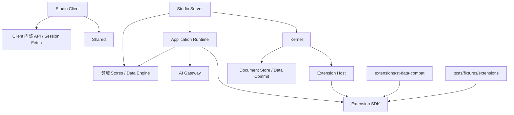

# 工作区包依赖关系图 (Dependency Graph)

> **状态**：Active Reference / Current Workspace Manifests Are Authority

下图只展示主要分层，不是全量依赖图。箭头表示使用方依赖被使用方；精确 dependencies 以各 Package 的 package.json 为准。声明依赖不代表当前某条业务路径实际调用了它。

## 主要依赖

关键入口：

- [Application Runtime manifest](../../../packages/application-runtime/package.json)
- [Kernel manifest](../../../packages/kernel/package.json)
- [Extension SDK manifest](../../../packages/extension-sdk/package.json)
- [Extension Host manifest](../../../packages/extension-sdk/extension-host/package.json)

## 核心约束

1. PromptBuild 由 Application 直接编译；Core / Runner / TraceAudit 原型已退役。
2. Kernel 不依赖 Application Runtime，不拥有 Card、Agent 或 Prompt 业务语义。
3. Host 实现依赖 SDK 作者合同，SDK 不反向依赖 Host；Host 物理目录嵌在 SDK 目录下不改变这个方向。
4. EventMeta / StudioEvent 由 SDK 提供；共享基础设施不得反向依赖具体 Application 或 Client。
5. 随主程序携带的轻量内容位于 `official/extensions/`，独立发行扩展的安装与本地开发位于根 `extensions/`，测试样本位于 `tests/fixtures/extensions/`；是否官方不改变安装位置。
6. Blob 与 Asset 共用 `@loom-studio/asset-store` 包入口，仍分别负责不可变字节和资产元数据；Document 的文件与内存工厂共用 SQLite 实现，写入上下文字段由 Data Engine 统一定义。
